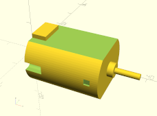
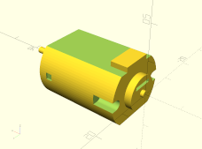
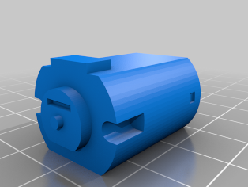
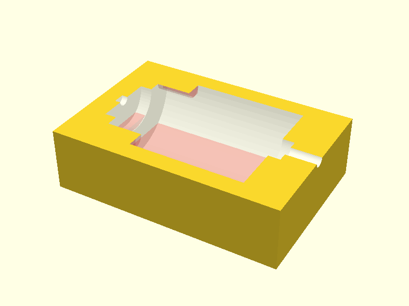

# BDC Motor SCAD

An OpenSCAD library that models a brushed DC hobby motor. The defaults are a
"130 size" motor, and every dimension is an argument.





## Usage

```openscad
use <bdc_motor.scad>

hobby_dc_motor();                                            // the 130 size motor
hobby_dc_motor(motor_body_x = 30, motor_axle_length = 48);   // a longer can and axle
```

The axle lies along the X axis and its driven end is the front. The back face
of the motor body is at x = 0; the rear protrusion and the back end of the
axle are at negative x.

Opening `bdc_motor.scad` itself shows the motor with every dimension in the
customizer.

### `hobby_dc_motor(...)`

Each argument has the name and default of the variable at the top of
`bdc_motor.scad`, where they are described. The ones that are not dimensions:

| Argument                         | Default | Meaning |
| -------------------------------- | ------- | ------- |
| `render_axle_separately`         | `true`  | Draw the axle as its own solid, separated from the body by a 0.05 mm sleeve. Pass `false` to get one solid, as when subtracting the motor from another part. |
| `render_wiring_clearance_blocks` | `false` | Add two blocks above the back cover that mark out room for the wires. |
| `body_alpha`, `trim_alpha`       | 40, 20  | Opacity of the body and of the trimmed areas in the preview, in percent. |
| `measurement_tol`                | 0.2     | How far a measured dimension may be from the one the others imply, in mm. |

The module stops with a message if the dimensions do not fit together: an axle
shorter than the motor, a back slot outside the rear protrusion, or a
`motor_back_protrusion_flat_bottom_width` that disagrees with the protrusion's
diameter and offset.

Circles use 128 fragments, or 64 in the preview, unless you set `$fn`.

### Derived dimensions

For placing other parts around the motor. Each takes the dimensions it depends
on as arguments and defaults to the 130 size motor.

| Function                    | 130 size | Meaning |
| --------------------------- | -------- | ------- |
| `motor_length()`            | 29       | The motor without the axle: rear protrusion, back cover, body and front protrusion. |
| `motor_axle_length()`       | 38       | Total axle length. |
| `motor_axle_outset_front()` | 8        | Axle protruding from the front protrusion. |
| `motor_axle_outset_back()`  | 1        | Axle protruding from the rear protrusion. |
| `motor_back_start_x()`      | 3        | From the back end of the axle to the back face of the body. |
| `motor_body_height()`       | 15       | Body height across the flats. |
| `motor_back_height()`       | 15       | Back cover height, the same as the body's. |
| `motor_side_notch_length()` | 6        | Length of the notches in the sides of the back cover. |

## Examples

- `examples/default_motor.scad`: the default motor.
- `examples/custom_motor.scad`: a longer can and axle.
- `examples/motor_pocket.scad`: the motor and its wiring clearance subtracted
  from a block.



## Reference motors

The "130 size" 6 V motor, with a 29 mm long body, that the original author used
for reference and testing:

- [Adafruit - DC Toy / Hobby Motor - 130 Size](https://www.adafruit.com/product/711)
- [Core Electronics - Brushed DC Motor - 130-Size](https://core-electronics.com.au/brushed-dc-motor-130-size-6v-11-5krpm-800ma-stall.html)

## Development

With [just](https://just.systems/) and OpenSCAD installed, `just test` renders
the library and every example with OpenSCAD warnings treated as errors.

## License

BSD 3-Clause. See [LICENSE](./LICENSE). The original is marked "BSD Licensed"
in its source, without naming a variant.

## Acknowledgement

Originally shared on [Thingiverse](https://www.thingiverse.com/thing:3932497)
by Craig Ringer <ringerc@ringerc.id.au> (Copyright 2019), and forked from
[ringerc/openscad-hobby-dc-motor](https://github.com/ringerc/openscad-hobby-dc-motor).
The fork connection was severed as this has diverged significantly from the
original.
